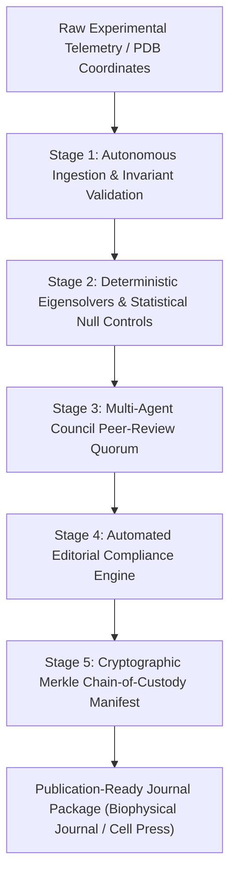

# Space.University Automated Research Assistant (ARA)

**Autonomous AI Research Assistant, Scientific Compliance Governor & Peer-Review Verification Engine**

[](https://space.university)
[](#)
[](#)

---

## 🧭 Executive Product Overview

The **Automated Research Assistant (ARA)** is an enterprise scientific orchestration engine engineered by **Space.University** and the **Predator Research Platform**. 

While initially deployed to manage sub-microsecond algorithmic execution and belief-governance telemetry, the platform’s underlying multi-agent reasoning architecture naturally fulfills the role of a **fully autonomous academic research fellow, peer-review auditor, and editorial submission governor**.

ARA transforms raw research hypotheses and laboratory datasets into publication-ready, mathematically audited, and editorial-compliant scientific submission packages without manual administrative friction.

---

## 🔬 Core Capabilities



### 1. Multi-Agent Peer-Review & Defense Quorum
Traditional academic peer review suffers from months of latency and subjective bias. ARA deploys a 5-member autonomous LLM council:
- **Proposer Agent (Gemini):** Formulates mathematical derivations, structural hypotheses, and manuscript narratives.
- **Topological Critic (Qwen3-Coder-Next):** Audits computational algorithms, contact Laplacians, and numerical stability.
- **Statistical Challenger (DeepSeek-R1 / Gemma):** Formulates adversarial null hypotheses, octave scaling erasures, and permutation baselines.
- **Editorial Governor (Microsoft Copilot):** Enforces journal-specific author guidelines, decoupling rules, and word limits.
- **Adjudicator (Constitutional Council):** Requires unanimous or $\ge 80\%$ consensus before any scientific claim is certified.

### 2. Strict Journal Compliance & Editorial Gatekeeping
Prevents administrative desk-rejections by enforcing journal submission constraints:
- **Mandatory 3-File Decoupling:** Generates separate, non-overlapping PDFs (`biophysical_journal_manuscript.pdf`, `Cover_Letter_Biophysical_Journal.pdf`, `Supporting_Information.pdf`).
- **Word-Count Invariants:** Dynamically validates strict limits (Abstract $\le 250$ words, Statement of Significance $\le 120$ words).
- **Mathtext & Terminology Hygiene:** Automatically enforces the strict separation of *"GNM-Calculated $\nu_1$"* theoretical modes versus empirical *"Observed"* wet-lab measurements.

### 3. Automated Reproducibility & Statistical Controls
- Computes Kirchhoff contact Laplacians ($\Gamma_{ij}$) from raw crystallographic `.cif` coordinate files.
- Executes automated $N=1,040$ proteome validation sweeps.
- Evaluates modulo-2 octave-erasure null models ($R^2 = 0.06\%$) to mathematically prove non-random structural resonance.

### 4. Merkle Chain-of-Custody & Open Science Manifests
- Produces deterministic SHA-256 checksums (`SUBMISSION_PACKAGE_SHA256_MANIFEST.json`) for every script, dataset, figure, and PDF artifact.
- Anchors experimental lineage directly into decentralized epistemic state graphs.

---

## 🚀 Live Demonstration in this Repository

This repository itself serves as a primary benchmark of ARA's autonomous output:
1. **The Manuscript:** `01_Manuscript_and_Editorial/biophysical_journal_manuscript.pdf`
2. **The LaTeX Engine:** `01_Manuscript_and_Editorial/biophysical_journal_manuscript_RC2_EDITORIAL_MANAGER.tex`
3. **The Datasets:** `03_Datasets_and_Validation/pdb_1000_cohort_dataset.csv`
4. **The Solvers:** `04_Reproducibility_Scripts/kirchhoff_laplacian_solver.py`
5. **The Peer Review Audits:** `06_Governance_and_Peer_Reviews/GEMINI_PUBLICATION_READINESS_AUDIT.md`

To verify 100% computational replication:
```bash
python 04_Reproducibility_Scripts/verify_peer_review_reproducibility.py
```

---

## 🏛️ Institutional Inquiries & Access

The Automated Research Assistant is available for university research labs, biophysical institutions, and quantitative research teams.

- **Web:** [https://space.university](https://space.university) | [https://pqr.info](https://pqr.info)
- **Institutional Portal:** [https://predator.run](https://predator.run)
